# Review — 02 · F2 오늘 거 올리기

> Vibe Studio · build-check · 최신 점검이 위에 있어요

## 2026-10-16 · 목표: UI 구현 · 걸어본 플로우: F2

**한 줄 결론:** 목표 순간(오늘 칸이 채워짐)까지 막힘 없이 가요. 다만 읽지 못한 캡처를 올리면 홈으로 못 돌아오는 막힘 1개가 있어요. 어긋남 없음, 위험 없음.

### 걸어본 길
| 단계 | 화면 | 결과 | 스크린샷 |
|:--:|------|------|------|
| ① | 홈(달력) — F1을 마친 직후 | 통과 — "2026년 10월", "이번 달 공용 230,020원", 16일 테두리 | 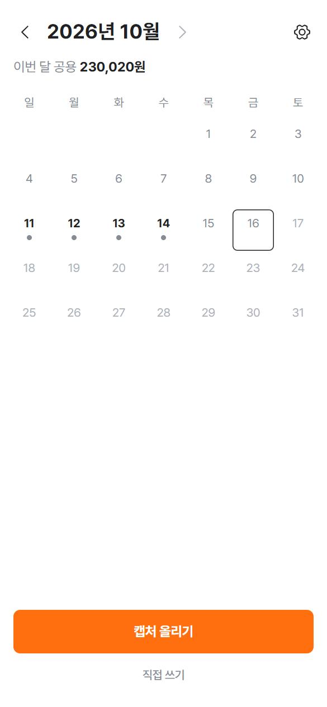 |
| ① | 홈 — ‹ 로 9월 | 통과 — 빈 달 문구, 합계 줄 숨김 · 10월에서 › 는 흐리고 안 눌림 | 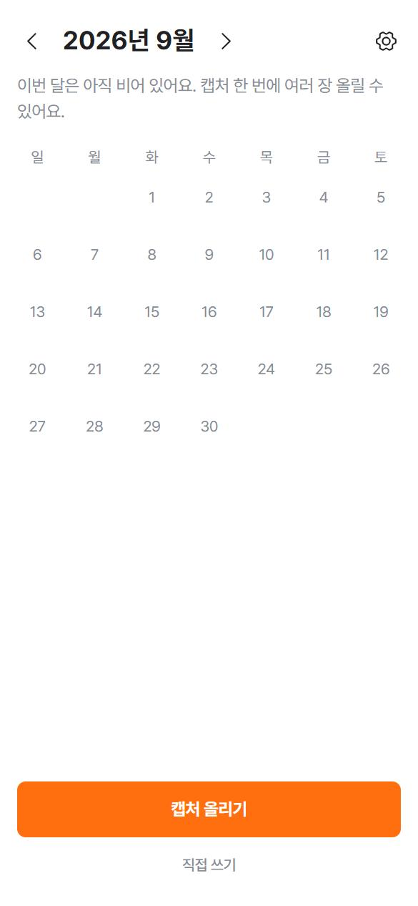 |
| 하루 카드 | 빈 날(10월 15일) | 통과 — 빈 문구와 "+ 직접 추가", [달력 보기] 눌러도 알림 안 물음 | 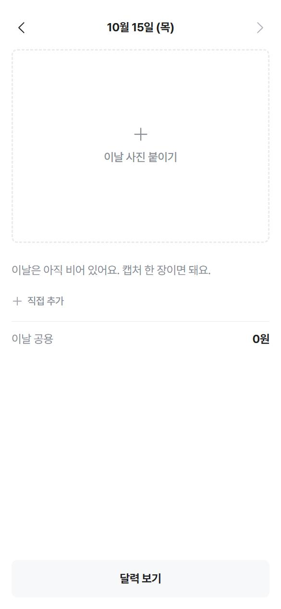 |
| ② | 정리 중 (캡처 2장) | 통과 | 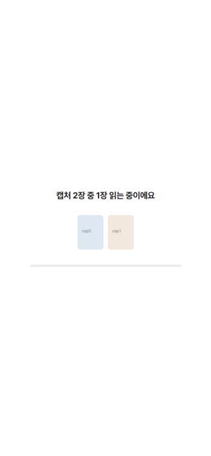 |
| ③ | 정리 결과 | 통과 — "이미 올린 결제 2건은 뺐어요.", 15·16일 4건 · 중간에 `/home`으로 다시 열면 정리 결과로 이어짐 | 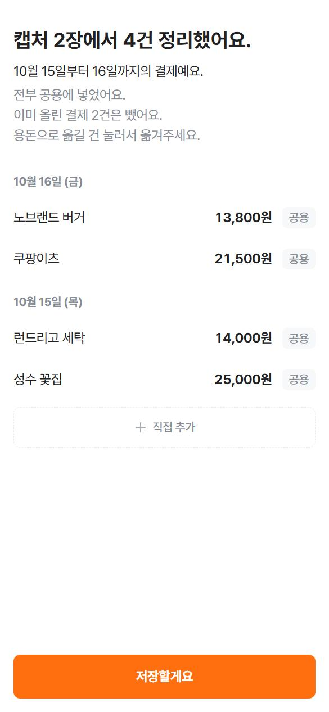 |
| ④ | 홈 — 채워진 칸 | 통과 — 카카오 안 묻고 홈으로, 15·16일 연한 주황 강조, "10월 15일·16일이 채워졌어요.", 합계 304,320원 · **목표 순간 도착** | 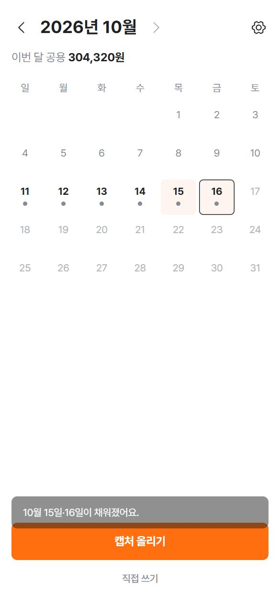 |
| 하루 카드 | 오늘(10월 16일) | 통과 — 노브랜드 버거·쿠팡이츠, 이날 공용 35,300원 | 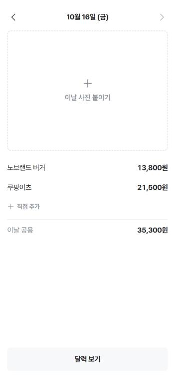 |
| ③ | 전부 이미 올린 결제 (`?ocr=dup`) | 통과 — "이미 올린 결제예요. 새로 넣을 내역은 없어요." + [홈으로] | 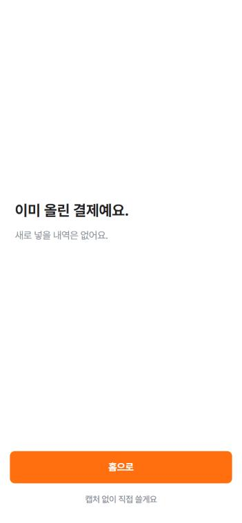 |
| ① → ③ | 홈 "직접 쓰기" → 정리 결과 | 통과 — "직접 쓴 1건이에요." | 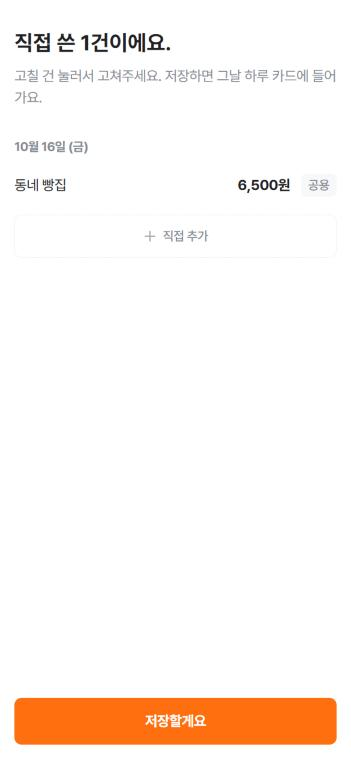 |
| ④ | 홈 — 직접 쓴 뒤 | 통과 — 16일 채워짐, 합계 304,320원 → 310,820원 | 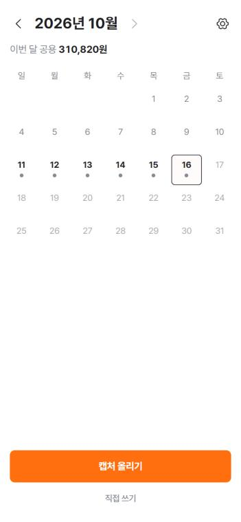 |
| 설정 | 톱니 → 설정 | 통과 — "저녁 알림" 스위치, "김콩알 · 카카오", "로그아웃" | 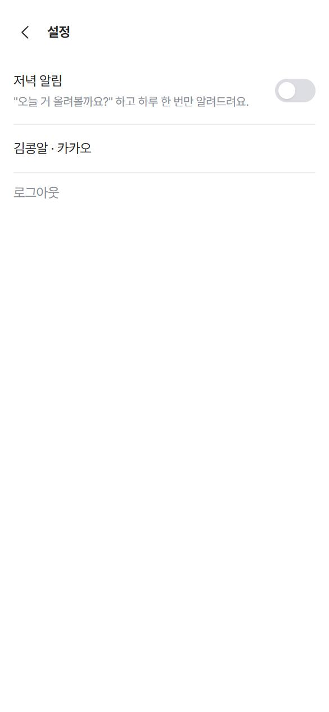 |
| 설정 | 알림 켜고 새로고침 | 통과 — 켜진 채 남음 | 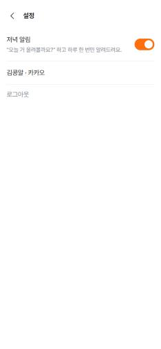 |
| 설정 | `?notify=blocked`에서 켜기 | 통과 — "알림이 꺼져 있어요. 설정에서 켜면 저녁에 알려드려요." | 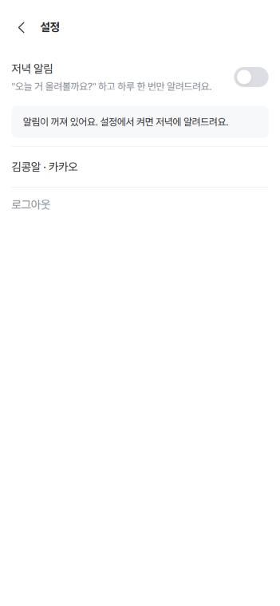 |
| 예외 | 로그아웃 뒤 `/home` | 통과 — "다시 시작할까요?" + [카카오로 시작] → 기록 그대로인 홈 | 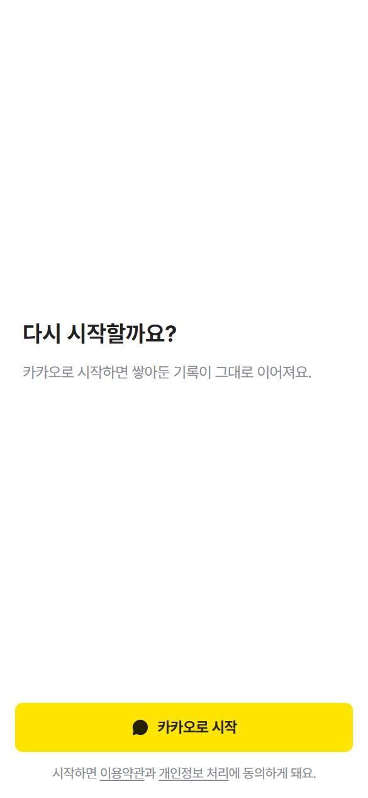 |
| ③ | 한 건도 못 읽음 (`?ocr=none`) | **막힘 1** | 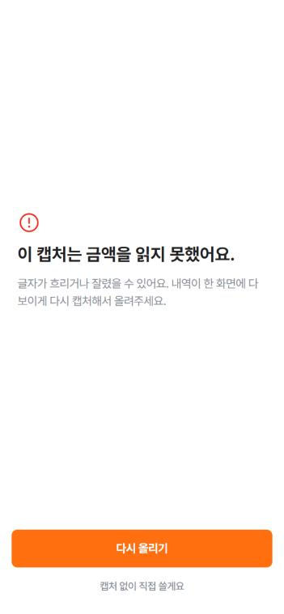 |

확인 기준 10개 중 10개 통과 · 콘솔 에러 없음(다시 만들 수 있는 것 기준) · 넓은 화면 괜찮음(가운데 한 줄로 보임, 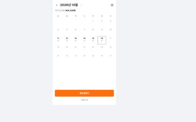)

그 밖에 해본 것: 하루 카드·설정·홈에서 새로고침 → 그대로 · 하루 카드에서 뒤로 가기 → 홈 · 정리 중에 새로고침 → 정리 결과로 이어짐 · `?ios=1` 설정에 홈 화면 추가 안내 한 줄 · 주황은 화면마다 주요 버튼 하나와 고른 상태(공용 칸, 켠 스위치)에만, 빨강은 "읽지 못했어요" 오류에만 쓰임 · VOICE 금지선의 말은 안 보임.

### 문제
| # | 종류 | 어디서 | 무엇이 | 고치려면 (build-slice에 그대로) |
|:--:|------|--------|--------|------|
| 1 | 막힘 | ③ 정리 결과, 한 건도 못 읽었을 때 (홈에서 `?ocr=none`으로 캡처 올림) | "이 캡처는 금액을 읽지 못했어요." 화면에 [다시 올리기]와 "캡처 없이 직접 쓸게요"만 있어서 달력으로 돌아갈 길이 없어요. 주소에 `/home`을 쳐도, 뒤로 가기를 해도, 앱을 다시 열어도 이 화면으로 돌아와요. 새 캡처를 올리거나 직접 써서 저장해야만 홈으로 나갈 수 있어요. | "이미 계정이 있는 사람이 홈에서 올린 캡처를 한 건도 못 읽었을 때, '이 캡처는 금액을 읽지 못했어요.' 화면에 회색 글자 버튼 [홈으로]를 두고, 읽은 내역이 0건인 결과는 남겨두지 않아서 다시 열면 홈(달력)이 나오게 해줘" |

### 다듬으면 좋을 것
- 9월 빈 날을 열었다가 [달력 보기]를 누르면 9월이 아니라 10월 달력으로 돌아가요. 보던 달로 돌아가면 지난달을 넘겨보기 편해요.
- 설정 화면 안에서 "설정에서 켜면 저녁에 알려드려요."가 나와서, 지금 보는 설정인지 휴대폰 설정인지 헷갈릴 수 있어요("휴대폰 설정에서 켜면"처럼).

### 기획과 달라진 점 (→ userflow-generator)
- 홈은 오늘이 있는 달로 열림, 오늘 뒤의 날짜 칸은 흐리게 눌리지 않음, 빈 하루 카드에도 "이날 공용 0원" 줄이 보임 (LOG 10/16 조각 1)
- 채워진 날 안내는 "3일이 채워졌어요." 대신 날짜를 직접 씀("10월 15일·16일이 채워졌어요.", 넷 이상이면 "10월 11일부터 14일까지 채워졌어요."), 안내는 [캡처 올리기] 위에 뜸 (LOG 10/16 조각 2)
- "이미 올린 결제예요." 화면에도 "캡처 없이 직접 쓸게요"가 있음 (LOG 10/16 조각 2, 화면에서 확인)
- 정리하다 만 결과가 있으면 홈 대신 정리 결과로 (LOG 10/16 조각 2, 화면에서 확인)
- 로그인이 풀린 채 돌아오면 시작하기 화면이 "다시 시작할까요? 카카오로 시작하면 쌓아둔 기록이 그대로 이어져요."로 바뀜 (LOG 10/16 조각 3)
- 설정의 저녁 알림 아래에 설명 한 줄("'오늘 거 올려볼까요?' 하고 하루 한 번만 알려드려요."), 아이폰이면 홈 화면 추가 안내 한 줄 (LOG 10/16 조각 3, 화면에서 확인)
- 로그아웃하면 시작 화면으로 감, 로그아웃 뒤 새 캡처를 올려 다시 시작하면 기존 기록에 더해짐(같은 결제 거르기는 안 함) (LOG 10/16 조각 3)
- 홈의 "직접 쓰기"는 쓴 뒤 정리 결과("직접 쓴 1건이에요.")를 한 번 거쳐 [저장할게요]로 저장됨 (화면에서 확인 — FLOWS F2 ① 단계표와 같고, SPEC 문장만 바로 저장처럼 읽힘)

### 다음
1. 문제 1을 build-slice로 고치기
2. userflow-generator로 "F2 만들었어, 달라진 점 반영해줘" — F2 상태가 UI 구현으로 바뀌어요
3. 다음 작업 묶음은 build-spec으로

**안전 점검:** 코드에 키처럼 생긴 값(`sk-`, secret, token, api key, 긴 문자열) 없음 · `.env`·`.env.*`가 `.gitignore`에 들어 있고 커밋된 적 없음 · `VITE_`로 시작하는 값이나 `import.meta.env`를 쓰는 곳 없음 · 진짜 저장소(Supabase)는 아직 안 씀.
